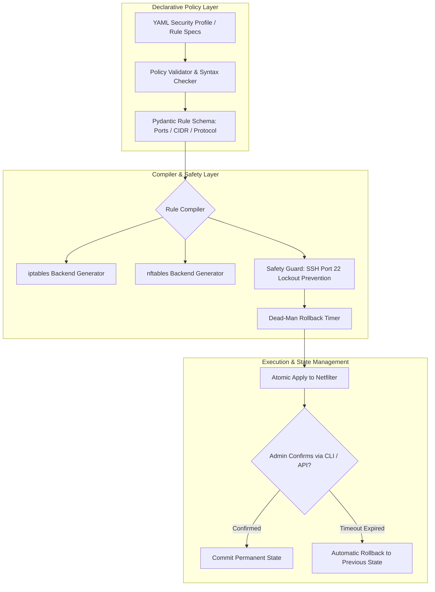

# Linux Firewall Manager (`fw-manager`)

Declarative Packet Filtering, Hardened Security Profiles, and Safe Rule Orchestration Engine for Linux with Automated Rollback.

[](https://github.com/Krish9800/linux-firewall-manager/actions)
[](LICENSE)
[](https://www.python.org/)
[](https://typer.tiangolo.com/)
[](https://netfilter.org/)

---

## Overview & Problem Statement

Managing Linux firewall rules via raw `iptables` or `nftables` commands is error-prone. A single misplaced drop rule or conflicting order can permanently lock administrators out of remote servers. Furthermore, auditability and version control are often absent in ad-hoc firewall administration.

**Linux Firewall Manager** is a declarative firewall policy compiler and orchestration engine. It allows administrators to define high-level security profiles in human-readable YAML, validates syntax before compilation, enforces strict default-deny policies, tests connectivity, and implements an automated **dead-man timer rollback** mechanism to prevent remote lockouts.

---

## Architecture & Data Flow



---

## Verified Features

- **Declarative YAML Profiles:** Define multi-tier server profiles (e.g. `web-server`, `database-node`, `bastion-host`) with clean human-readable syntax.
- **Fail-Safe Dead-Man Timer:** Automatically reverts firewall rules if the administrator does not issue an explicit `confirm` command within a configurable window (default: 60s), eliminating SSH lockout risks.
- **Multi-Backend Compilers:** Compiles verified rules into both legacy `iptables` and modern `nftables` syntax.
- **Strict Default-Deny Architecture:** Automatically configures drop-all ingress policies while permitting established and related stateful connections.
- **REST Control Plane & CLI:** Full support for terminal management or automated fleet orchestration via FastAPI endpoints.

---

## Technology Stack

- **Runtime:** Python 3.12+
- **Data Validation:** Pydantic v2 & Pydantic-Settings
- **Configuration:** PyYAML
- **CLI Framework:** Typer & Rich
- **API Framework:** FastAPI & Uvicorn
- **Testing:** Pytest, Ruff, Mypy, Bandit

---

## Requirements & Installation

```bash
# Clone the repository
git clone https://github.com/Krish9800/linux-firewall-manager.git
cd linux-firewall-manager

# Create and activate virtual environment
python3 -m venv .venv
source .venv/bin/activate

# Install dependencies
pip install -e .
```

---

## Verified Usage Examples

### 1. Command-Line Interface (CLI)

```bash
# Check current firewall status and active rules
fw-manager status

# List available pre-configured security profiles
fw-manager list-profiles

# Apply a hardened web server profile with a 60-second safety timer
fw-manager apply-profile web-server --timeout 60

# Confirm rules to cancel the dead-man timer and commit state
fw-manager confirm

# Manually trigger an immediate rollback to the previous configuration
fw-manager rollback

# Export active rules to an nftables configuration file
fw-manager export --format nftables --output /etc/nftables.conf
```

### 2. REST API Service

```bash
# Launch the firewall management daemon
uvicorn fwmanager.api.app:app --host 127.0.0.1 --port 8000
```

Endpoints available at `http://127.0.0.1:8000/docs`:
- `GET /health` — Health check
- `GET /api/v1/rules` — List active firewall rules
- `POST /api/v1/rules` — Add a new rule dynamically
- `DELETE /api/v1/rules/{rule_id}` — Remove an existing rule
- `GET /api/v1/profiles` — List available profiles

---

## Testing & Quality Gates

```bash
# Run unit and rule compiler tests
pytest --cov=fwmanager --cov-report=term-missing

# Linting and static analysis
ruff check .
ruff format --check .
mypy src/fwmanager
```

---

## Security Model & Threat Boundaries

- **Lockout Prevention:** Safety rules strictly forbid removing port 22 (SSH) when applying rules over an active SSH session unless explicitly overridden.
- **Validation Before Application:** Every rule is validated for valid CIDR masks, port boundaries (1–65535), and protocol types before touching system tables.
- **Least-Privilege Execution:** Can run in dry-run/simulation mode without root privileges; applying to system netfilter tables requires `sudo` or `CAP_NET_ADMIN`.

---

## Limitations & Known Issues

- **Host Scope:** Designed for host-level Linux firewall management; enterprise distributed SDN controllers (e.g. Calico, Cilium) are outside this tool's scope.
- **IPv6 Translation:** Advanced IPv6 extension header parsing is planned for future versions.

---

## License & Responsible Use

This project is licensed under the **MIT License** — see the [LICENSE](LICENSE) file for details.

> [!NOTE]
> Designed for Linux system administrators, DevSecOps engineers, and hardened infrastructure teams.
