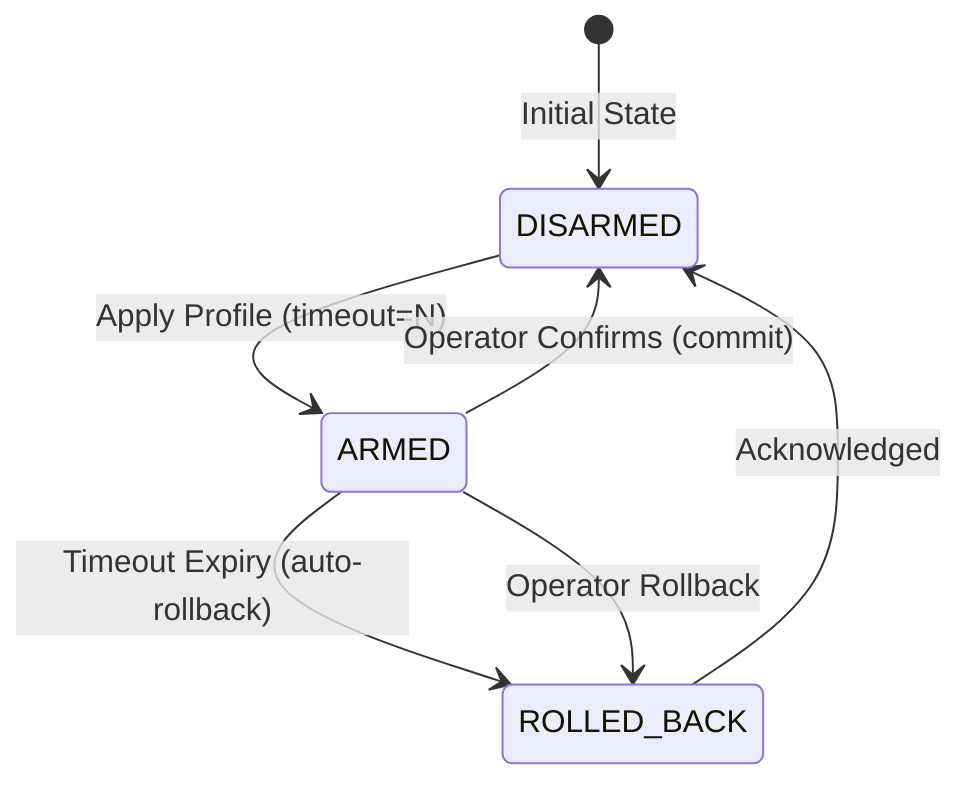

# Linux Firewall Manager Architecture

## 1. System Overview

**Linux Firewall Manager** is a defense-in-depth Linux host packet filtering engine designed to enforce declarative security policies across `nftables` and legacy `iptables` subsystems. 

The architecture is built upon three foundational tenets:
1. **Declarative State & Strict Typing**: All firewall rules are modeled as strongly typed domain primitives with compile-time and runtime validation against command injection.
2. **Lock-Safe Deadman's Switch**: Remote policy transitions require explicit operator confirmation; unconfirmed rule sets automatically roll back after a countdown window to prevent remote operator SSH lockout.
3. **Dual Execution Runtime**: Allows air-gapped simulation for CI/CD test runs without kernel privileges, alongside atomic kernel enforcement using `nft -f -` or structured `iptables` invocation.

```mermaid
graph TD
    CLI[Typer / Rich CLI] --> Core[Core Firewall Engine]
    API[FastAPI REST Service] --> Core
    
    subgraph Core Engine
        Sanitizer[Strict Input Sanitizer]
        Model[Declarative Rules & Policy Models]
        Switch[Deadman's Switch Safety Engine]
        CompNFT[nftables Compiler]
        CompIPT[iptables Compiler]
        CEF[ArcSight CEF & JSON Exporter]
    end
    
    Core --> Sanitizer
    Sanitizer --> Model
    Model --> Switch
    Switch --> CompNFT
    Switch --> CompIPT
    Switch --> CEF
    
    subgraph Drivers
        SimDriver[Simulation Driver (In-Memory)]
        KernelDriver[Linux Kernel Driver]
    end
    
    CompNFT --> SimDriver
    CompNFT --> KernelDriver
    CompIPT --> SimDriver
    CompIPT --> KernelDriver
```

---

## 2. Component Breakdown

### 2.1 Declarative Models (`src/fwmanager/models/`)
- `FirewallRule`: Immutable rule entity specifying chain (`INPUT`, `OUTPUT`, `FORWARD`), protocol (`tcp`, `udp`, `icmp`, `all`), port/port-range (`80`, `8080:8090`), interface binding (`interface_in`, `interface_out`), connection state tracking, and target action (`ACCEPT`, `DROP`, `REJECT`, `LOG`).
- `ChainDefaultPolicy`: Sets table chain default ingress/egress disposition (e.g. Default DROP).
- `FirewallPolicy`: Complete atomic configuration with unique name, description, chain defaults, and rule sequence.

### 2.2 Compilation Layer (`src/fwmanager/compilers/`)
- `NftablesCompiler`: Emits atomic `table inet filter { ... }` blocks with atomic flush guarantees.
- `IptablesCompiler`: Compiles policy into sequential, deterministic `iptables -A ...` commands.

### 2.3 Deadman's Switch Safety Engine (`src/fwmanager/safety/`)


- When a risky transition is requested, the switch captures a deep clone of the current working firewall state.
- The new policy is staged into the active driver.
- A background monitoring thread counts down from the specified timeout (default 30 seconds).
- If `confirm()` is called within the window, the timer is aborted and the configuration persists.
- If timeout fires without confirmation, the registered rollback callback restores the previous snapshot immediately.

### 2.4 Telemetry & SIEM Integration (`src/fwmanager/telemetry/`)
- Conforms to **ArcSight Common Event Format (CEF:0)**.
- Formats `FW-100` (Policy Application with SHA-256 fingerprint) and `FW-200` (Individual Rule Lifecycle Modifications).
